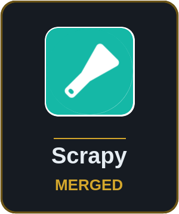
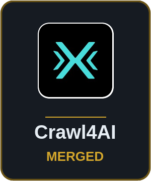
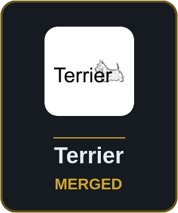

# Omar Bounawara

**BACKEND & DATA ENGINEERING &nbsp;·&nbsp; PYTHON &nbsp;·&nbsp; SYSTEMS**

I build backend services and data pipelines in Python, and I like checking them against real data.

[GitHub](https://github.com/omarbounawarapy) · [LinkedIn](https://www.linkedin.com/in/omar-bounawara-py) · [Email](mailto:omar.bounawara.py@gmail.com)

## Things I've built

### CrawlViz

`research project` A crawler that picks which links are worth following. On one run it explored 539 of 50,828 links.

- Cheap embedding filter first, LLM only for unclear pages
- 13 pipelines talking over one async event bus
- Live React/D3 graph of the crawl
- About 40x faster after switching to concurrent fetching

[Repo](https://github.com/omarbounawarapy/CrawlViz)

 

### GAAPWise

`client` A pipeline that sorts and scores French legal announcements (BODACC). It ran through a month of real data, 318,962 records, with zero errors.

- Rule-based scoring, no ML in the decisions
- 17x faster by batching database commits
- Same input always gives the same decisions

[Demo video](https://drive.google.com/file/d/1pDHOMM-HOdADbsOL1z3_fMRcbcmwycKZ/view)

 

### Wasel

`team of 5` Predicts whether a cash-on-delivery customer will refuse the parcel, from a chat in Darija, Arabizi or French. It passes a 476-case evaluation gate.

- LLM reads the chat, XGBoost picks the score
- Every quoted reason checked against the chat
- Keeps answering when an LLM provider goes down
- Prototype on synthetic data

[Live demo](https://wasel.runs-on.dev)

 

### Invoice Intake

`solo` Turns messy invoice PDFs into clean JSON, CSV or Excel records, backed by 209 regression tests.

- Handles table and paragraph layouts
- Reads mixed regional number formats
- No OCR or LLM, fully deterministic

[Repo](https://github.com/omarbounawarapy/invoice_intake_automation_tool)

 

### IR Lab

`from scratch` A small search engine framework using only the standard library, tested on the CISI collection.

- Boolean and TF-IDF retrieval
- Significance test written from scratch
- Refuses to compare runs that differ in more than one setting

[Repo](https://github.com/omarbounawarapy/IR-lab)

---

## Open source

<!-- One <a> per merged PR, 6 per row. Make the badge with scripts/make_badge.sh <slug> "<Name>" <logo> [square or circle:#hex], copy a line, and replace one locked slot with it. Add a locked line to start a new row. -->

  
  
  
  
  
  

- [scrapy/scrapyd#579](https://github.com/scrapy/scrapyd/pull/579): docs for running scrapyd as a Linux service
- [unclecode/crawl4ai#2327](https://github.com/unclecode/crawl4ai/pull/2327): fix for proxy passwords with special characters
- [terrier-org/terrier-core#271](https://github.com/terrier-org/terrier-core/pull/271): restored the TREC indexing docs after the wiki went offline

---

## Stack

**Daily**

  
  
  
  
  
  
  
  
   
  Python · FastAPI · SQLite · SQL · Git · Linux · GitHub Actions · pytest

**In some projects**

  
  
  
  
  
  
  
  
   
  React · Docker · aiohttp · Pandas · PySpark · Pydantic · scikit-learn · OpenRouter

**Still learning**

  
  
  
  
  
   
  JavaScript · Tailwind CSS · Java · LangChain · Hugging Face

---

 Arabic &nbsp;·&nbsp;  French &nbsp;·&nbsp;  English

Studying computer engineering at ISI, Université de Tunis El Manar.
